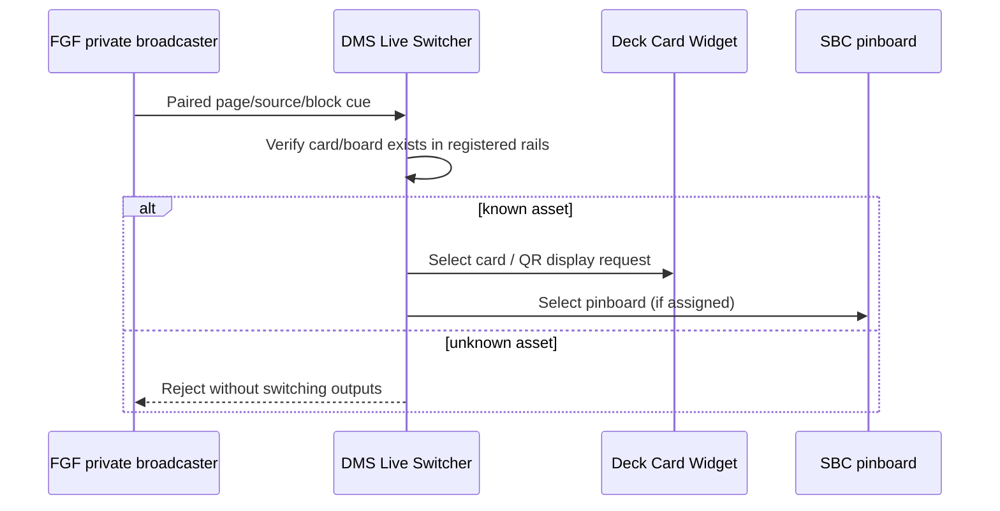

<div align="center">

# 🎛️ DMS Live Switcher
### Studio transitions without hunting through windows.

**A local desktop controller for Deck Cards, pinboards, timing cues, and Field Guide Forge automation.**

[](https://python.org) [](#release-status) [](#local-integration-and-pairing) [](#what-it-does)

**[Overview](#what-it-does) · [Quick start](#quick-start) · [Studio Cues](#field-guide-forge-studio-cues) · [Pairing](#local-integration-and-pairing) · [Safety](#privacy-and-safe-publishing)**

</div>

---

## What it does

**DMS Live Switcher** brings the repetitive switching work of a live production into one local interface. It coordinates saved **Deck Card Widget** collections (`.buttstore`), **Streamer Board & Console** pinboards (`.sboard`) and pre-show sequencing. The November 2026 alpha series also integrates with **Field Guide Forge (FGF)**, so changing the presenter page can select the corresponding studio output.

> [!NOTE]
> DMS is a control layer, not a replacement for Deck Card Widget or Streamer Board & Console. The target applications keep ownership of their own assets and output windows.

## Features at a glance

| Workflow | Capability |
|:--|:--|
| Deck Card rail | Switch among registered Deck Card Widget cards and collections |
| Pinboard rail | Switch saved SBC pinboards and sticker configurations |
| Pre-Show | Sequence named segments; manage ordering, triggers, delays and rows |
| Timing | Configure countdowns, sticker timing and transition-related actions |
| Tethers | Trigger additional connected actions through configured rows |
| Live QR | `Change Display: FULL-DATA / QR-DATA` to the left of `Hide Click` |
| Connection feedback | Report OFFLINE when DCW is unavailable instead of claiming a successful change |
| FGF Studio Cues | Apply registered deck/pinboard/display actions from page, source or block changes |

### QR-data control

The **Change Display** button reads back the *confirmed* live state rather than assuming that a request succeeded. Changing the live mode does not erase the saved display preference inside an individual DCW card.

### Pre-Show and custom timing

DMS provides a production board for handling repeatable segments (including partnership and sponsorship arrangements, catch-up segments, endings and credits). Existing pre-show row editing and timing options are designed to work alongside manual controls—use manual overrides when an unexpected live moment requires it.

## Quick start

### Requirements

- Python 3, Tkinter and any dependencies in the checkout's current setup/requirements files.
- **[Deck Card Widget](https://github.com/DigiMancer3D/Deck-Card-Widget)** for deck-card rendering.
- **[Streamer Board & Console](https://github.com/DigiMancer3D/Streamer-Board-Console)** for pinboard and shared app operations.
- **[Field Guide Forge](https://github.com/DigiMancer3D/Field-Guide-Forge)** only if you want automated broadcaster cues.

```bash
# From the DMS-Live-Switcher repository directory
bash ./run.sh
```

If your installed checkout does not include `run.sh`, use its documented platform launcher or run `python3 dms_live_switcher.py` with the required environment. Don't replace a working installed version with an older standalone alpha source.

### First integration test

1. Start Deck Card Widget and Streamer Board & Console.
2. Open DMS and use its app-location controls to find the installed directories if necessary.
3. Select a known registered card. Confirm the DCW output updates.
4. Click **Change Display** and confirm the status reflects FULL-DATA or QR-DATA.
5. Close DCW to confirm DMS reports its unavailable state safely.

## Field Guide Forge Studio Cues

The private **FGF broadcaster** can request the configured studio output when its presenter navigates to a page, changes an evidence source, or activates a content block.



For show reliability, FGF's **Auto Cues** switch can be disabled during navigation. Assignments reference card IDs and registered collections rather than embedding raw `.buttstore` contents into a broadcaster page.

## Local integration and pairing

The alpha bridge communicates over the **local loopback interface**. DMS listens on `127.0.0.1:48373` and requires a pairing code for broadcaster requests. The browser stores the active pairing only for the current session; the code does **not** belong in a saved `.fgf`, public HTML or GitHub repository.

To pair an FGF broadcaster, use the DMS **Change Display** button's right-click option to copy the FGF pairing code and enter it into the broadcaster's **UNPAIRED** prompt. Once paired, FGF can send the active page's Studio Cue. If a cue is rejected, verify the referenced card/board is already present in DMS's configured rails.

> [!CAUTION]
> This is a **local studio bridge**, not an Internet-facing web API. Do not expose its loopback port publicly, commit tokens, or host private broadcaster controls on a public site.

## Source map

| File or directory | Responsibility |
|:--|:--|
| `dms_live_switcher.py` | Main DMS UI and show controls |
| `dms_qr_display_switcher.py` | QR-data requests, state/acknowledgements and Studio Cues bridge |
| `dms_live_deck_bridge.py` | Deck Card Widget integration |
| `switch_core.py`, `deck_order.py`, `tether_core.py` | Core switching, ordering and tether helpers where present |
| `run.sh`, `verify.sh` | Platform launcher/verification helpers where included |
| `assets/`, `docs/`, `tests/` | Design assets, documentation and tests where included |

### Testing after updating source

```bash
python3 -m py_compile dms_live_switcher.py dms_qr_display_switcher.py
```

This verifies syntax, not the whole inter-app connection. Confirm DMS ↔ DCW QR switching and FGF cue validation in the live desktop environment before using it in a production show.

## Privacy and safe publishing

Never commit saved local switch layouts, personal profile data, actual `.sboard`/`.buttstore` collections, private source paths, pairing codes, backup files, or material inside `~/.local/share/dms-live-switcher/`. Prefer generic or deliberately sanitized fixtures and templates. Keep the stable source modules and documentation in GitHub; keep real studio state on your machine.

## Troubleshooting

<details><summary><strong>FGF is paired but the deck card does not switch</strong></summary>

Check that the selected card is registered in DMS's rail and that FGF Auto Cues is ON. DMS intentionally rejects unknown IDs rather than selecting a different card.

</details>

<details><summary><strong>Change Display reports OFFLINE</strong></summary>

Start DCW, check the Deck-side bridge module is present, and restart DMS. Do not assume a button click succeeded until DMS reports the acknowledged state.

</details>

<details><summary><strong>Why does a QR-pinned card stay QR when the button shows FULL-DATA?</strong></summary>

The button reflects the live *global override*, not a command to rewrite every card's stored display preference.

</details>


---

## Related projects

[Deck Card Widget](https://github.com/DigiMancer3D/Deck-Card-Widget) · [Streamer Board & Console](https://github.com/DigiMancer3D/Streamer-Board-Console) · [Field Guide Forge](https://github.com/DigiMancer3D/Field-Guide-Forge) · [DMST hub](https://github.com/DigiMancer3D/DMST)

Built by **[DigiMancer3D](https://github.com/DigiMancer3D)**. 

